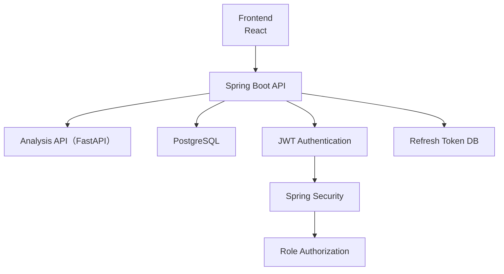
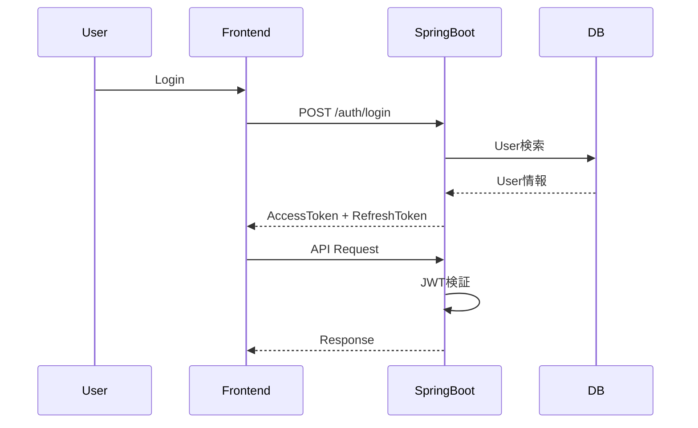
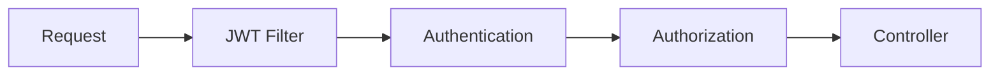
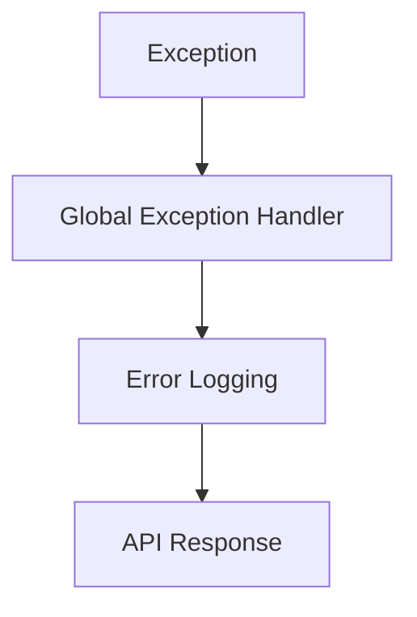

# 09_Security_Design

# **セキュリティ設計書**

## **ドキュメント情報**

| **項目** | **内容** |
| --- | --- |
| Project | 大ペット（だいペット） |
| Document | Security Design |
| Author | Koh Hanyeong |
| Status | Draft |
| Updated | 2026-10-25 |

---

# **1. セキュリティ設計概要**

本ドキュメントでは、「大ペット」におけるセキュリティ設計方針を定義する。

本システムでは以下のセキュリティ対策を実施する。

- JWT認証
- Role Based Authorization
- Password暗号化
- Refresh Token管理
- HTTPS通信
- CORS制御
- 入力値Validation
- SQL Injection対策
- XSS対策
- CSRF対策
- Logging監査
- Rate Limit対策

---

# **2. セキュリティアーキテクチャ**



---

# **3. 認証設計**

# **3-1. 認証方式**

JWT Bearer Authenticationを利用する。

```
Authorization: Bearer {access_token}
```

---

# **3-2. Token構成**

| **Token** | **用途** | **保存場所** | **送受信方式** |
| --- | --- | --- | --- |
| Access Token | API認証 | Frontend Memory | Authorization Header (Bearer) |
| Refresh Token | Token再発行 | Frontend State | Request Body / Response Body |

> **注記（MVP方針）:** Refresh TokenはMVP段階ではRequest Body方式で実装する。セキュリティ強化フェーズでHttpOnly Cookie方式への移行を検討する。

## **Claim構成**

| **Token** | **Claim** |
| --- | --- |
| Access Token | `sub`（userId） / `email` / `role` / `type=access` / `iat` / `exp` |
| Refresh Token | `jti`（発行ごとのUUID） / `sub`（userId） / `type=refresh` / `iat` / `exp` |

`type` claimでTokenの用途を区別する。`JwtAuthenticationFilter`は`type=access`かつ`role`を持つTokenのみ認証情報を設定し、それ以外（Refresh Tokenを含む）は認証せずに次のフィルターへ進める（結果として401 AUTH-001）。

`jti`が無いと`iat`/`exp`が秒単位のため、同一ユーザーが同一秒に再発行したRefresh Tokenが同一文字列となり`refresh_tokens.token`のUNIQUE制約に衝突する。発行ごとにUUIDを付与して回避する。

---

# **3-3. Token有効期限**

| **Token** | **有効期限** |
| --- | --- |
| Access Token | 30分 |
| Refresh Token | 14日 |

---

# **3-4. Refresh Token管理**

Refresh TokenはDBで管理する。

対象テーブル:

```
refresh_tokens
```

---

# **3-5. Refresh Token失効条件**

| **条件** | **内容** |
| --- | --- |
| Logout | revoked=true |
| Token再発行 | 旧Token失効 |
| 有効期限超過 | 使用不可 |
| ユーザー停止（管理者、`07_API_Design` §11-4） | 対象ユーザーの全Token失効 |

再発行時の失効は`UPDATE ... WHERE token = ? AND revoked = false`の条件付きUPDATEで行い、**更新件数が1件の呼び出しのみ**が後続Tokenを発行できる。同時リフレッシュやログアウト後の再利用は0件更新となりAUTH-003を返す（rotationの単一消費）。

さらに、ログイン・再発行・ログアウトはいずれも**対象ユーザー行を`SELECT ... FOR UPDATE`で排他取得してから**Tokenを操作する。これが無いと、再発行が旧Tokenを失効させて後続Tokenをinsertする間に、ログイン／ログアウトの一括revoke（`WHERE user_id = ? AND revoked = false`）が走り、後続Tokenをスナップショットから取りこぼす。結果としてログアウト成功後もセッションが生き残る、あるいは有効なRefresh Tokenが2本残る（`docs/12` §3-11）。ユーザー単位の直列化により「有効なRefresh Tokenは1ユーザー1本」の不変条件が3操作すべてで保たれる。

Access Token自体は失効リストを持たないが、認証フィルター（`JwtAuthenticationFilter`）が**リクエストごとにユーザーの現在の状態と権限をDBから確認**する。停止中・論理削除済み・存在しないユーザーは有効なAccess Tokenでも認証せず（401）、権限はTokenの`role`ではなく現在の値を使う。これにより管理者による停止・権限変更は、Tokenの残り有効期限（最長30分）を待たず次のリクエストから反映される（`08_State_Design` §3-4「API利用不可」）。代償として認証付きリクエストごとに主キー検索が1回増える。 ログインは排他取得後に状態をDBから読み直し（同じトランザクションで読み込み済みのUserはキャッシュのため列を直接読む）、最初の読み取り後に停止が確定していた場合はAUTH-002でTokenを発行しない。

---

# **3-6. 認証フロー**



---

# **4. Authorization設計**

# **4-1. 認可方式**

Role Based Authorizationを採用する。

---

# **4-2. Role一覧**

| **Role** | **説明** |
| --- | --- |
| ROLE_USER | 一般利用者 |
| ROLE_HOSPITAL_ADMIN | 病院管理者 |
| ROLE_SYSTEM_ADMIN | システム管理者 |

---

# **4-3. 権限制御対象**

| **API** | **ROLE_USER** | **ROLE_HOSPITAL_ADMIN** | **ROLE_SYSTEM_ADMIN** |
| --- | --- | --- | --- |
| ペット登録 | ○ | × | ○ |
| 予約申請 | ○ | × | ○ |
| 予約承認・予約一覧（病院管理者） | × | △ | ○ |
| 予約枠・営業時間の管理、病院更新 | × | △ | ○ |
| 病院登録・停止、病院管理者の紐付け | × | × | ○ |
| ユーザー管理 | × | × | ○ |

△: 紐付いた病院のみ（§4-5）。詳細は`07_API_Design` §14。

---

# **4-5. 病院所属チェック（リソース単位の認可）**

Roleの確認（`@PreAuthorize`）に加え、病院を操作するApplication Service（予約枠・営業時間・病院更新・予約の承認／却下／診療完了・病院管理者向け予約一覧）は、最初に`HospitalAccessChecker.checkManageable(userId, hospitalId)`を呼ぶ。

| **Role** | **判定** |
| --- | --- |
| ROLE_SYSTEM_ADMIN | すべての病院を許可 |
| ROLE_HOSPITAL_ADMIN | `hospital_admins`（`06_ERD` §11）に紐付けがある病院だけ許可 |
| その他 | 拒否 |

拒否は403 **HOSPITAL-005**。判定に使う権限はTokenではなくDBの現在の値で、紐付けもリクエストごとに確認するため、解除・権限変更は次のリクエストから反映される（§3-5）。予約の操作では予約の病院で判定する。ペットの`owner check`と同じく、パスの`hospitalId`と対象リソースの病院の一致も別途確認する（HOSPITAL-002・003）。

紐付けの登録（`07_API_Design` §11-10）は、権限変更と同じユーザー行の排他を取ってから権限を確認する。権限を`ROLE_HOSPITAL_ADMIN`以外へ変更すると、紐付けはすべて削除される。

---

# **4-6. 分析API（FastAPI）の認証**

| **項目** | **内容** |
| --- | --- |
| 経路 | フロントエンド → Spring（JWT認証・ペットの所有者チェック）→ 分析APIの内部API（07 §7-5） |
| 分析APIの認証 | `X-Internal-Api-Key` ヘッダーを環境変数 `INTERNAL_API_KEY` と定数時間比較（`hmac.compare_digest`）。不一致・未送信は 401（INTERNAL-001）。キーが未設定なら全て拒否する |
| ユーザー認証 | 分析APIは JWT を扱わない。利用者の認証・認可は Spring だけが行う |
| DB | Spring と同じDBを読み取りのみで参照する（接続時に `default_transaction_read_only=on` を指定し、DB側でも書き込みを禁止。テーブルは作らない） |
| CORS | 分析APIはブラウザから呼ばれないため CORS を設定しない |
| エラー応答 | 存在しないURL・想定外の例外も共通エラー形式で返し、トレースバックはサーバー（uvicorn）のログにだけ出す。API文書（`/docs`・`/openapi.json`）は公開しない |
| 公開範囲 | 本番では分析APIのポートを外部に公開しない（ローカルの Docker Compose は開発用に 8000 を公開） |

---

# **4-4. Spring Security設定方針**



---

# **5. Password管理**

# **5-1. Password暗号化**

BCryptを利用する。

```java
BCryptPasswordEncoder
```

---

# **5-2. Passwordポリシー**

| **項目** | **内容** |
| --- | --- |
| 最小文字数 | 8文字 |
| 英数字混在 | 必須 |
| 平文保存 | 禁止 |

---

# **5-3. Password保存方針**

| **項目** | **内容** |
| --- | --- |
| DB保存 | Hash化 |
| ログ出力 | 禁止 |
| API Response | 禁止 |

---

# **6. HTTPS設計**

# **6-1. HTTPS必須化**

本番環境ではHTTPS通信を必須とする。

---

# **6-2. Cookie設定**

> **注記（MVP方針）:** MVP段階ではRefresh TokenをRequest Body方式で実装するため、Cookie設定は本番移行時に適用する。

| **項目** | **値** | **適用フェーズ** |
| --- | --- | --- |
| HttpOnly | true | 本番移行時 |
| Secure | true | 本番移行時 |
| SameSite | Strict | 本番移行時 |

---

# **7. CORS設計**

# **7-1. 許可Origin**

| **環境** | **Origin** |
| --- | --- |
| Local | http://localhost:5173 |
| Production | https://daipetto.example.com |

---

# **7-2. 許可Method**

- GET
- POST
- PUT
- PATCH
- DELETE

---

# **8. CSRF対策**

# **8-1. CSRF方針**

JWT認証を利用するため、Spring Security標準CSRFは無効化する。

---

# **8-2. Refresh Token送受信方式**

MVP段階ではRefresh TokenをRequest Body / Response Bodyで送受信する。

| **フェーズ** | **方式** | **CSRF対策** |
| --- | --- | --- |
| MVP | Request Body / Response Body | JWT Stateless認証によりCSRFリスク限定的 |
| 本番移行時 | HttpOnly Cookie (SameSite=Strict) | Cookie設定によりCSRF低減・XSSリスク排除 |

---

# **9. XSS対策**

# **9-1. 対策方針**

| **対策** | **内容** |
| --- | --- |
| React利用 | 基本Escape |
| dangerouslySetInnerHTML | 原則禁止 |
| 入力Validation | HTML制限 |

---

# **9-2. 禁止事項**

- HTML直接保存
- Script Tag許可

---

# **10. SQL Injection対策**

# **10-1. Spring Boot**

JPA Parameter Bindingを利用する。

---

# **10-2. Analysis API（FastAPI）**

psycopg のパラメータバインディング（`%s`）を利用する。

---

# **10-3. 禁止事項**

- String連結SQL
- Native Query乱用

---

# **11. Validation設計**

# **11-1. Backend Validation**

Spring Validationを利用する。

```java
@Valid
@NotNull
@Size
@Email
```

---

# **11-2. Validation対象**

| **項目** | **条件** |
| --- | --- |
| Email | RFC形式 |
| Password | 8文字以上 |
| Pet Name | 20文字以内 |
| Memo | 1000文字以内 |

---

# **11-3. Frontend Validation**

React Form Validationを実施する。

---

# **12. Rate Limit設計**

# **12-1. Rate Limit対象**

| **API** | **制限** |
| --- | --- |
| Login API | 5回 / 1分 |
| Refresh API | 10回 / 1分 |

---

# **12-2. 異常検知**

以下を監視対象とする。

- Login連続失敗
- Token異常利用
- 予約大量生成

---

# **13. Logging・監査設計**

# **13-1. 監査ログ対象**

| **対象** | **内容** |
| --- | --- |
| Login | 認証成功/失敗 |
| Reservation | 状態変更 |
| User Status | 停止/復旧 |
| Hospital Status | 停止/復旧 |

---

# **13-2. ログ禁止情報**

- Password
- JWT全文
- Refresh Token全文
- 個人情報全文

---

# **13-3. Error Logging**



---

# **14. ファイルUploadセキュリティ**

# **14-1. 対象**

ペット画像Upload

---

# **14-2. 制限**

| **項目** | **内容** |
| --- | --- |
| 拡張子 | jpg/png/webp |
| 最大サイズ | 5MB |
| MIME Type検証 | 必須 |

---

# **14-3. 保存方針**

| **項目** | **内容** |
| --- | --- |
| Local保存 | 禁止 |
| Object Storage | 利用 |
| URL保存 | DB保存 |

---

# **15. Schedulerセキュリティ**

# **15-1. Scheduler対象**

| **Scheduler** | **用途** |
| --- | --- |
| ワクチン通知 | 通知生成 |
| 予約枠自動生成 | 営業中の全病院の翌月分の予約枠生成（毎月1日 00:00 JST）。ユーザー権限を持たないため所属チェックは行わず、管理画面からの手動生成（`07_API_Design` §8-11）は所属チェック（§4-5）を通す |

---

# **15-2. 制御方針**

| **項目** | **内容** |
| --- | --- |
| 重複通知防止 | 必須 |
| Transaction管理 | 必須 |
| Error Logging | 必須 |

---

# **16. DBセキュリティ**

# **16-1. DB接続**

| **項目** | **内容** |
| --- | --- |
| ORM | JPA / psycopg（パラメータバインディング） |
| DB User権限 | 最小権限 |
| Root接続 | 禁止 |

---

# **16-2. 論理削除**

履歴保持のため論理削除を採用する。

---

# **17. Docker Security**

# **17-1. Container構成**

| **Container** | **用途** |
| --- | --- |
| frontend | React |
| spring-api | Spring Boot |
| analysis-api | FastAPI |
| postgres | PostgreSQL |

---

# **17-2. Security方針**

| **項目** | **内容** |
| --- | --- |
| 不要Port公開 | 禁止 |
| ENV直書き | 禁止 |
| Secret管理 | .env利用 |

---

# **18. エラーレスポンス設計**

## **Response形式**

```json
{
  "success": false,
  "data": null,
  "code": "AUTH-001",
  "message": "認証に失敗しました。"
}
```

---

# **19. セキュリティ監視対象**

| **対象** | **内容** |
| --- | --- |
| Login Fail | 異常認証 |
| API Error | 500監視 |
| Scheduler Error | 通知異常 |
| DB Error | 接続異常 |

---

# **20. 設計上考慮事項**

## **Access Token短期化**

Access Tokenは短期有効期限とし、漏洩リスクを低減する。

---

## **Refresh Token DB管理**

強制Logout、Token失効制御を可能にするためDB管理する。

---

## **状態遷移保護**

状態変更APIはRole権限および状態遷移ルールで制御する。

---

## **API責務分離**

認証・予約などの業務APIはSpring Boot、分析系APIはFastAPIで管理する。

---

# **21. 今後追加予定セキュリティ**

| **項目** | **内容** |
| --- | --- |
| MFA | 二段階認証 |
| WAF | Web Application Firewall |
| API Gateway | Rate Limit強化 |
| Redis Blacklist | JWT失効管理 |
| Security Header | CSP / HSTS |

---

# **22. 依存ライブラリの脆弱性管理**

| **項目** | **内容** |
| --- | --- |
| 確認方法 | リポジトリ直下で `node scripts/osv-scan.mjs`。Spring の runtimeClasspath、frontend の `package-lock.json`（推移的依存を含む）、分析APIの Python 環境を OSV（osv.dev）で照合する。送るのは公開パッケージの名前とバージョンだけ |
| 実施時期 | 依存の追加・更新時、月1回、大きな脆弱性が報道されたとき |
| 更新方針 | 修正版のある最小のパッチ・マイナーへ上げる。公開から3日未満のバージョンは避ける（npm の公開アカウント乗っ取り事例があるため。`npm audit fix --before=<日付>`） |
| Spring Boot | 3.5.16 は 3.x 最後の OSS 版（3.x の OSS サポートは 2026-06-30 で終了）。OSS で修正が続く部品（Tomcat・Jackson・PostgreSQL JDBC・Log4j API）は `build.gradle` の `ext[...]` で修正版へ上げる。Spring 本体の今後の修正には 4.x への移行が必要（TODO.md） |

## **22-1. 2026-10-25 の対応**

| **対象** | **対応前** | **対応後** | **主な脆弱性** |
| --- | --- | --- | --- |
| Spring Boot（Framework / Security / Data Commons） | 3.3.13（6.1.21 / 6.3.10 / 3.3.13） | 3.5.16（6.2.19 / 6.5.11 / 3.5.13） | HTTPレスポンスヘッダーが出力されない場合がある（CVE-2026-22732、CRITICAL）、Spring MVC のパストラバーサル・DoS |
| Tomcat | 10.1.42 | 10.1.61 | 認証・認可の迂回（CVE-2026-43515・CVE-2026-65182・CVE-2026-68525 など、CRITICAL）、HTTPリクエストスマグリング |
| Jackson | 2.17.3 | 2.21.8 | PolymorphicTypeValidator の迂回、DoS |
| PostgreSQL JDBC | 42.7.7 | 42.7.14 | SCRAM 認証の DoS、チャネルバインディングのダウングレード |
| Logback / Log4j API | 1.5.18 / 2.23.1 | 1.5.34 / 2.25.5 | 逆シリアライズ、JSON 出力のエンコード |
| Capacitor（Android / iOS） | 8.4.1 | 8.4.3 | 外部コンテンツをアプリのオリジンで読み込める（CVE-2026-103922、CRITICAL） |
| Axios | 1.18.1 | 1.20.0 | プロトタイプ汚染、ReDoS、リダイレクト経由の SSRF |
| React Router DOM | 6.30.4 | 6.30.6 | オープンリダイレクト経由の XSS（CVE-2026-53668） |
| Vite（開発用） | 6.4.3 | 6.4.4 | 開発サーバーの配信制限の迂回 |
| npm の推移的依存 | tar・brace-expansion・follow-redirects・@xmldom/xmldom・postcss ほか | 修正版 | `npm audit fix --before=2026-10-20` |
| Docker イメージ | `node:20.20.2-alpine`（Node 20 はサポート終了）・`python:3.12.10-slim`・`postgres:16.9` | `node:24.22.1-alpine`・`python:3.12.15-slim`・`postgres:16.15` | Node.js の 2026-10-20 セキュリティリリース（Node 20 には修正なし） |

テストでは `@MockBean`（Boot 3.4 で非推奨・Boot 4 で削除）を `@MockitoBean` に置き換えた。結果: OSV で脆弱性のあるパッケージは 31 → 3（下表）。

## **22-2. 影響なしと判断して残したもの（2026-10-25）**

| **対象** | **脆弱性** | **影響なしの理由** | **解消の予定** |
| --- | --- | --- | --- |
| spring-webmvc 6.2.19 | CVE-2026-47884（XsltView）、CVE-2026-47890（SSE の fragment 描画） | XSLT ビューも SSE も使っていない（REST + JSON のみ） | Spring Boot 4.x への移行 |
| react-router 6.30.6 | CVE-2026-53666（SSR の hydration）、CVE-2026-53669（`<Link>`・`useNavigate` の `\` によるオープンリダイレクト） | SSR を使わない SPA。遷移先はコード内の固定パスか、`/pets/{id}` のように先頭を固定したパスだけで、外部入力の URL へは遷移しない | React Router 7 への移行 |
| postcss-selector-parser 6.1.5（開発用） | CVE-2026-104844（CPU 消費） | ビルド時だけ動き、対象は自前の CSS | Tailwind CSS 4 への移行 |

