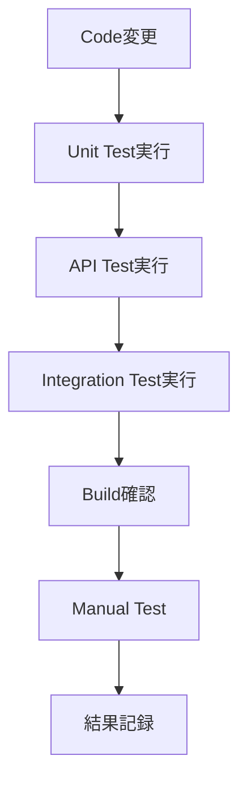
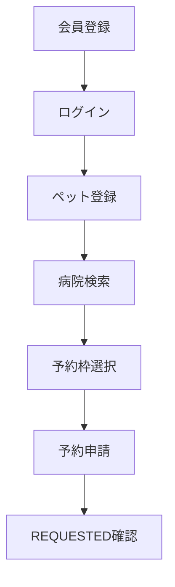
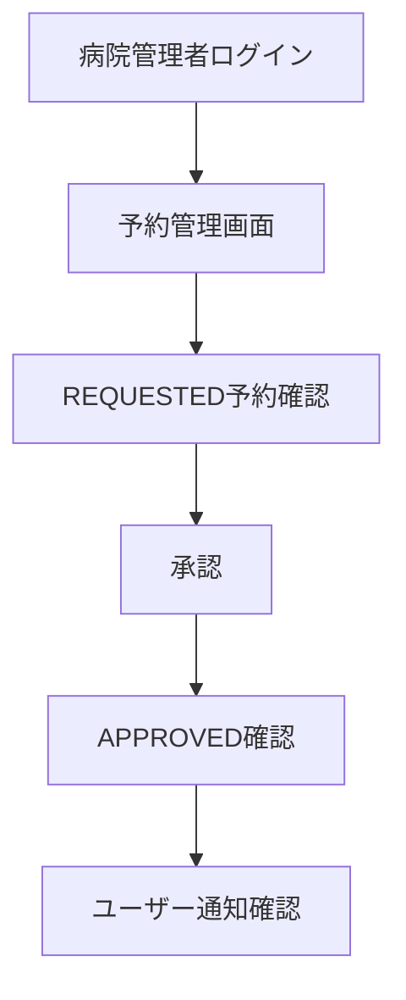
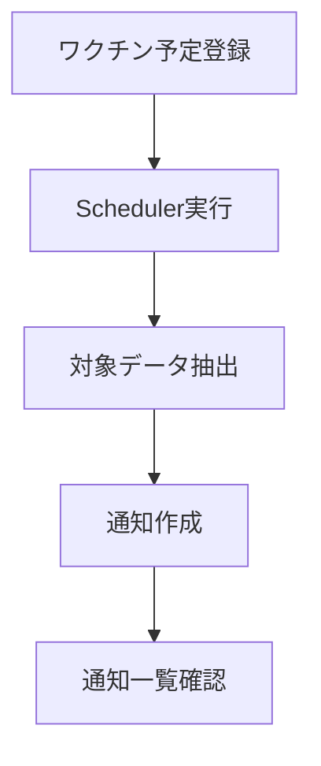

# 11_Test_Strategy

# **テスト戦略書**

## **ドキュメント情報**

| **項目** | **内容** |
| --- | --- |
| Project | 大ペット（だいペット） |
| Document | Test Strategy |
| Author | Koh Hanyeong |
| Status | Draft |
| Updated | 2026-10-23 |

---

# **1. テスト戦略概要**

本ドキュメントでは、「大ペット」におけるテスト方針、テスト対象、テスト観点、テスト環境、テスト実施範囲を定義する。

本システムでは、認証、予約、状態遷移、権限制御、通知、分析APIを中心にテストを実施する。

特に以下を重点確認対象とする。

- 認証・認可の正常性
- Role別アクセス制御
- 予約状態遷移の整合性
- 重複予約防止
- Scheduler通知処理
- API Response形式
- DB Migration整合性

---

# **2. テスト対象範囲**

| **対象** | **内容** |
| --- | --- |
| Frontend | 画面表示、入力Validation、API通信 |
| Spring Boot API | 認証、予約、ペット、通知、権限制御 |
| Django Analysis API | 健康記録分析、統計API |
| PostgreSQL | テーブル制約、Migration、Index |
| Docker Compose | Container間通信、環境起動 |
| Scheduler | ワクチン通知処理 |

---

# **3. テスト種別**

| **テスト種別** | **目的** | **対象** |
| --- | --- | --- |
| Unit Test | 単一処理の検証 | Service / Utility |
| Repository Test | DBアクセス検証 | Repository / Query |
| API Test | Request / Response検証 | Controller / Endpoint |
| Integration Test | 複数コンポーネント連携検証 | Spring Boot / DB |
| E2E Test | 画面から業務完了まで確認 | Frontend + Backend |
| Security Test | 認証・認可検証 | JWT / Role |
| Migration Test | DB変更検証 | Flyway |
| Scheduler Test | 定期処理検証 | Vaccine Notification |

---

# **4. テスト環境**

## **4-1. Local Test Environment**

| **項目** | **内容** |
| --- | --- |
| Frontend | React 18.3.1 |
| Node.js | 24.17.0 |
| Spring Boot | 3.3.13 |
| Java | 17 |
| Python | 3.12.10 |
| Django REST Framework | 3.15.2 |
| PostgreSQL | 16.9 |
| Container | Docker Compose v2 |

---

## **4-2. Test Database**

| **項目** | **内容** |
| --- | --- |
| Unit Test | DB不使用（Repository を Mockito でモック） |
| Integration Test | 未導入（導入時は PostgreSQL Testcontainers を想定） |
| Local Manual Test | Docker PostgreSQL |

> **注記:** Repository をモックする単体テストでは null 許容パラメータの `@Query` 不具合を検出できない（`12_Trouble_Shooting` §3-10 の実例参照）。null 許容パラメータを含む `@Query` には実DB接続の統合テスト追加が望ましい。

---

# **5. テスト実行フロー**



---

# **6. テスト観点**

# **6-1. 認証テスト**

| **Test ID** | **観点** | **期待結果** |
| --- | --- | --- |
| AUTH-T001 | 正常ログイン | Access Token / Refresh Token発行 |
| AUTH-T002 | パスワード不一致 | AUTH-001返却 |
| AUTH-T003 | 存在しないユーザー | AUTH-001返却 |
| AUTH-T004 | 停止ユーザー | AUTH-002返却 |
| AUTH-T005 | Refresh Token再発行 | 新Access Token発行 |
| AUTH-T006 | 失効Refresh Token利用 | AUTH-003返却 |
| AUTH-T007 | ログアウト | Refresh Token revoked=true |
| AUTH-T008 | 同時リフレッシュ（既に消費済みToken） | 失効0件 → AUTH-003返却 |
| AUTH-T009 | Refresh TokenをAuthorization Bearerに使用 | 認証情報を設定せず例外も発生しない（401 AUTH-001） |
| AUTH-T010 | 同一ユーザー・同一秒のRefresh Token連続発行 | Token文字列が重複しない（`jti`） |
| AUTH-T011 | 再発行の最中にログアウト | ログアウト後に有効なRefresh Tokenが残らない |
| AUTH-T012 | 再発行の最中にログイン | 有効なRefresh Tokenはログイン発行分の1本のみ |
| AUTH-T013 | 同時ログイン | 直列化され、有効なRefresh Tokenは1本のみ |

---

# **6-2. Role認可テスト**

| **Test ID** | **Role** | **操作** | **期待結果** |
| --- | --- | --- | --- |
| ROLE-T001 | ROLE_USER | ペット登録 | 成功 |
| ROLE-T002 | ROLE_USER | 予約承認 | 403 |
| ROLE-T003 | ROLE_HOSPITAL_ADMIN | 予約承認（紐付いた病院の予約） | 成功（紐付いていない病院はHOSPITAL-005、6-2「病院所属」） |
| ROLE-T004 | ROLE_HOSPITAL_ADMIN | 病院登録・停止・病院管理者の紐付け | 403 |
| ROLE-T005 | ROLE_SYSTEM_ADMIN | 病院管理 | 成功 |
| ROLE-T006 | 未認証 | 認証必須API | 401 |
| ROLE-T007 | ROLE_USER・ROLE_HOSPITAL_ADMIN | ユーザー管理（`/api/v1/admin/users`） | 403 |

### **ユーザー管理**

| **Test ID** | **観点** | **期待結果** |
| --- | --- | --- |
| ADMIN-T001 | 検索（キーワード・権限・状態・ページ） | 部分一致（大文字小文字無視）、論理削除済みを除外、ID昇順、ページ情報付き。パスワードは返さない |
| ADMIN-T002 | ユーザー停止 | SUSPENDED、全Refresh Token失効、発行済みAccess Tokenでも次のリクエストから401、ログインはAUTH-002 |
| ADMIN-T003 | 停止解除 | ACTIVE、再ログイン可能 |
| ADMIN-T004 | 権限変更 | 次のリクエストから新しい権限で認可される |
| ADMIN-T005 | 自分自身の停止・権限変更 | USER-005 |
| ADMIN-T006 | 存在しない権限名・状態名 | VALIDATION-001（500にしない） |
| ADMIN-T007 | 停止と同時に進行中のログイン・Token再発行 | 停止の確定後に有効なRefresh Tokenが残らない（ログインはAUTH-002、再発行は後続Tokenを失効） |
| ADMIN-T008 | 最後のページの最後の1件が停止・権限変更で条件から外れる | 画面は最後の有効なページを取り直す（空のページに留まらない） |

### **病院所属（hospital_admins）**

| **Test ID** | **観点** | **期待結果** |
| --- | --- | --- |
| HADM-T001 | 紐付いていない病院の更新・予約枠・営業時間・予約の承認／却下／診療完了・予約一覧（病院管理者） | 403 HOSPITAL-005、データは変わらない |
| HADM-T002 | 紐付いた病院の同じ操作（病院管理者）／任意の病院（システム管理者） | 成功 |
| HADM-T003 | 管理対象の病院一覧（`/admin/hospitals/mine`） | システム管理者は停止中を含む全病院、病院管理者は紐付いた病院だけ |
| HADM-T004 | 紐付け | 201。重複HOSPITAL-007、一般ユーザーHOSPITAL-006、存在しない病院HOSPITAL-001、存在しない・削除済みユーザーUSER-003 |
| HADM-T005 | 同じ紐付けの同時登録 | 1件だけ成立し、残りはHOSPITAL-007 |
| HADM-T006 | 紐付け解除 | 次のリクエストから操作不可。紐付けが無ければHOSPITAL-008 |
| HADM-T007 | 権限を病院管理者以外へ変更 | 紐付けがすべて削除され、再び病院管理者にしても戻らない |
| HADM-T008 | 権限変更と同時に進行中の紐付け | 権限変更の確定後に紐付けが残らない（紐付けはHOSPITAL-006） |
| HADM-T009 | 予約一覧（病院管理者）の絞り込み | 状態・日付で絞り込み、条件なしは全件（PostgreSQLのnull条件）、論理削除済みの予約は除外、日付・開始時刻順 |

> HADM-T001〜T007は`HospitalAdminServiceTest`・各Service／Controllerテスト・`HospitalAdminPersistenceAdapterTest`（H2）、HADM-T009は`ReservationAdminQueryTest`（H2）と`GetAdminReservationListServiceTest`で検証する。実PostgreSQL・実HTTPでの確認（HADM-T005・T008を含む）は受け入れスクリプト（`.ai-collab/tasks/2026-10-22-hospital-admins/scripts/`）で行う。

> ADMIN-T001は`UserPersistenceAdapterTest`（H2）と`AdminUserServiceTest`、ADMIN-T002〜T006は`AdminUserServiceTest`・`AdminUserControllerTest`・`JwtAuthenticationFilterTest`で検証し、実PostgreSQL・実HTTPでの確認は受け入れスクリプト（`.ai-collab/tasks/2026-10-21-user-management/scripts/`）で行う。

---

# **6-3. ペット管理テスト**

| **Test ID** | **観点** | **期待結果** |
| --- | --- | --- |
| PET-T001 | ペット登録 | 登録成功 |
| PET-T002 | ペット名未入力 | Validation Error |
| PET-T003 | 他ユーザーのペット詳細取得 | 403 |
| PET-T004 | ペット更新 | 更新成功 |
| PET-T005 | ペット削除 | deleted_at設定 |
| PET-T006 | 名前51文字・品種101文字・負の体重・桁数超過の体重 | Validation Error（VALIDATION-001） |
| PET-T007 | 性別を省略した登録 | 登録成功（性別は任意項目、V14でNULL許可） |
| PET-T008 | 品種・不妊手術・マイクロチップを含む更新 | 全項目が置き換わり、論理削除済みのペットは更新されない（PET-001） |

> PET-T006・T007は`PetControllerTest`、PET-T008は`PetServiceTest`（モック）と`PetPersistenceAdapterTest`（H2で条件付きUPDATEの列を確認）で検証する。

### **共通（日時形式）**

| **Test ID** | **観点** | **期待結果** |
| --- | --- | --- |
| COMMON-T001 | 応答の日時 | JSTのオフセット付き・秒単位（`2026-05-20T10:00:30+09:00`）。`NotificationControllerTest`で検証 |

---

# **6-4. 健康記録テスト**

| **Test ID** | **観点** | **期待結果** |
| --- | --- | --- |
| HEALTH-T001 | 健康記録登録 | 登録成功 |
| HEALTH-T002 | 他ユーザーのペットに記録登録 | 403 |
| HEALTH-T003 | 体重に負数入力 | Validation Error |
| HEALTH-T004 | 健康記録一覧取得 | 登録済データ取得 |
| HEALTH-T005 | 健康記録削除 | deleted_at設定 |
| HEALTH-T006 | 一部項目のみのPATCH（例: memoのみ）・空のPATCH | 未指定項目は既存値を維持 |
| HEALTH-T007 | symptom / memo に空文字を指定したPATCH | 該当項目のみNULLに消去 |
| HEALTH-T008 | 論理削除のcommit後に書き込まれるPATCH | HEALTH-001、記録は削除状態のまま |
| HEALTH-T009 | 別項目への更新がcommitされるまで待たされたPATCH（例: memo更新中のweightのみ・空のPATCH、別項目を変える2つのPATCHの同時実行） | 未指定項目は確定済みの最新値を維持し、双方の変更が残る |

> HEALTH-T008・T009の同時実行は単体テスト（モック）とH2では再現できない。単体テストは行ロック付き読み取りを使うこと、`@DataJpaTest`はその読み取りが論理削除済みを除外することまでを確認し、インターリーブ自体は実PostgreSQLの受け入れスクリプト（`.ai-collab/tasks/2026-10-03-health-notification/scripts/`）で確認している。

### **ワクチン接種予定**

| **Test ID** | **観点** | **期待結果** |
| --- | --- | --- |
| VAC-T001 | 接種予定登録・一覧 | SCHEDULEDで登録、予定日の昇順で取得 |
| VAC-T002 | 他ユーザーのペットへの操作 | VACCINATION-002 |
| VAC-T003 | SCHEDULED→COMPLETED / CANCELLED、CANCELLED→SCHEDULED | 遷移元の状態だけを条件付きUPDATEで更新 |
| VAC-T004 | 許可されない遷移・同時実行で負けた遷移 | VACCINATION-003 |
| VAC-T005 | 論理削除 | deleted_at設定、一覧・リマインダー対象外。同時削除で負けた側はVACCINATION-001 |

> VAC-T001〜T005は`VaccinationServiceTest`（モック）・`VaccinationControllerTest`・`VaccinationPersistenceAdapterTest`（H2で条件付きUPDATEを実行）で確認する。

---

# **6-5. 病院・予約枠テスト**

| **Test ID** | **観点** | **期待結果** |
| --- | --- | --- |
| HOSP-T001 | 病院一覧取得 | ACTIVE病院のみ取得 |
| HOSP-T002 | 停止病院への予約 | RESERVATION-009（2026-09-13 R-05対応で002から変更。RSV-T007と同一観点） |
| HOSP-T003 | 停止の直前に読み取った内容での病院情報更新 | statusはSUSPENDEDのまま（情報列だけを更新） |
| HOSP-T004 | 情報更新の直前に読み取った内容での病院停止 | 更新済みの情報を古い値で上書きしない |
| SCH-T001 | AVAILABLE予約枠取得 | 取得成功 |
| SCH-T002 | BLOCKED予約枠予約 | RESERVATION-003 |
| SCH-T003 | 過去予約枠予約 | RESERVATION-005 |
| GEN-T001 | 営業時間から予約枠を生成 | 開始〜休憩開始・休憩終了〜終了はAVAILABLE、休憩はBLOCKED。区間の端数は作らない。0時をまたぐ枠を作らない。秒を含む境界を切り捨てない。保存済みの営業時間外の休憩でも営業時間外に枠を作らない |
| GEN-T002 | 既に枠がある日・営業時間の無い曜日 | 枠がある日は作らず`skippedDates`に数える（手動のBLOCKEDを上書きしない）。休診日は作らない |
| GEN-T003 | 同じ月の再実行・同時実行 | 枠は増えない。同時実行でも同じ（日付・開始時刻）の枠が二重にできない（病院行の排他） |
| GEN-T004 | 月の範囲 | 過去の月・13か月以上先はHOSPITAL-010。今月は今日（JST）以降だけ |
| GEN-T005 | 月次バッチ | 営業中の病院だけ、翌月の1日〜月末。1病院の失敗で他の病院を止めない |
| GEN-T006 | 営業時間の入力検証 | 開始>=終了、単位5分未満・240分超、休憩の片方だけ・営業時間外はHOSPITAL-009 |

> GEN-T001・T006は`HospitalBusinessHoursTest`、GEN-T002〜T005は`HospitalScheduleGenerationServiceTest`、日付の問い合わせ・一括保存・病院行の排他取得は`HospitalSchedulePersistenceAdapterTest`（H2）で検証する。実PostgreSQL・実HTTPでの確認（同時実行と排他待ちを含む）は受け入れスクリプト（`.ai-collab/tasks/2026-10-22-schedule-generation/scripts/`）で行う。cron起動そのものは自動テストしていない。

---

# **6-6. 予約テスト**

| **Test ID** | **観点** | **期待結果** |
| --- | --- | --- |
| RSV-T001 | 正常予約申請 | REQUESTED作成 |
| RSV-T002 | 同一schedule_id重複予約 | RESERVATION-001 |
| RSV-T003 | 他人ペット予約 | RESERVATION-004 |
| RSV-T004 | 予約キャンセル | CANCELLED更新 |
| RSV-T005 | COMPLETED予約キャンセル | 状態遷移エラー |
| RSV-T006 | 予約詳細取得 | 正常取得 |
| RSV-T007 | SUSPENDED病院への予約申請 | RESERVATION-009 |
| RSV-T008 | 論理削除済みペットを含む予約一覧取得 | 当該予約も他の予約も表示される |

---

# **6-7. 予約状態遷移テスト**

| **Test ID** | **現在状態** | **操作** | **期待状態** |
| --- | --- | --- | --- |
| STATE-T001 | REQUESTED | 承認 | APPROVED |
| STATE-T002 | REQUESTED | 却下 | REJECTED |
| STATE-T003 | REQUESTED | キャンセル | CANCELLED |
| STATE-T004 | APPROVED | 診療完了 | COMPLETED |
| STATE-T005 | APPROVED | キャンセル | CANCELLED |
| STATE-T006 | COMPLETED | 承認 | 不正遷移エラー |
| STATE-T007 | REJECTED | 承認 | 不正遷移エラー |
| STATE-T008 | CANCELLED | 承認 | 不正遷移エラー |
| STATE-T009 | REQUESTED（直前に他の遷移が成立） | 承認 / 却下 | 条件付き更新0件 → RESERVATION-008 |
| STATE-T010 | APPROVED（直前に他の遷移が成立） | 診療完了 / キャンセル | 条件付き更新0件 → RESERVATION-008 |

---

# **6-8. 通知テスト**

| **Test ID** | **観点** | **期待結果** |
| --- | --- | --- |
| NOTI-T001 | 予約承認通知 | RESERVATION_APPROVED作成 |
| NOTI-T002 | 予約却下通知 | RESERVATION_REJECTED作成 |
| NOTI-T003 | 診療完了通知 | TREATMENT_COMPLETED作成 |
| NOTI-T004 | 通知一覧取得 | ユーザー別通知取得 |
| NOTI-T005 | 通知既読処理 | is_read=true |

---

# **6-9. Schedulerテスト**

| **Test ID** | **観点** | **期待結果** |
| --- | --- | --- |
| SCHD-T001 | SCHEDULEDワクチン検索 | 対象抽出 |
| SCHD-T002 | 接種7日前通知 | VACCINATION通知作成 |
| SCHD-T003 | COMPLETEDワクチン | 通知対象外 |
| SCHD-T004 | CANCELLEDワクチン | 通知対象外 |
| SCHD-T005 | 通知重複防止 | 重複作成なし |

> **実装済みテスト（2026-10-05、2026-10-21更新）:** SCHD-T001/T003/T004/T005は`VaccinationPersistenceAdapterTest`（H2の`@DataJpaTest`で抽出クエリと送信済み化の条件付きUPDATEを実行）、SCHD-T002は`VaccinationServiceTest`で検証する。抽出後に中止・再登録が確定した場合に古い予定日の通知を作らず、新しい予定日が未送信のまま残ること（Codex REVIEW-001 R-03）も同テストで確認する。Schedulerのcron起動そのものは自動テストしていない。

---

# **6-10. Django Analysis APIテスト**

| **Test ID** | **観点** | **期待結果** |
| --- | --- | --- |
| ANA-T001 | 健康分析取得 | weightTrend返却 |
| ANA-T002 | 症状統計取得 | symptomStatistics返却 |
| ANA-T003 | データなし | 空配列返却 |
| ANA-T004 | 他ユーザーのペット分析 | 403 |

---

# **7. API Response確認**

## **Success Response**

```json
{
  "success": true,
  "data": {}
}
```

---

## **Error Response**

```json
{
  "success": false,
  "code": "RESERVATION-001",
  "message": "既に予約済みです。"
}
```

---

# **8. Migration Test**

## **8-1. 確認対象**

| **項目** | **内容** |
| --- | --- |
| Table作成 | 06_ERD通り作成されること |
| FK制約 | 正常に作成されること |
| Index | 検索対象Indexが作成されること |
| Default | Status初期値が設定されること |

---

## **8-2. Migration確認コマンド**

```json
./gradlew flywayMigrate
```

---

## **8-3. Build確認**

```json
./gradlew clean build
```

---

# **9. Frontend Test観点**

| **Test ID** | **観点** | **期待結果** |
| --- | --- | --- |
| FE-T001 | ログイン画面表示 | 表示成功 |
| FE-T002 | 入力Validation | エラー表示 |
| FE-T003 | API通信成功 | 画面更新 |
| FE-T004 | API Error | エラーメッセージ表示 |
| FE-T005 | Role別画面制御 | 不要メニュー非表示 |

---

# **10. E2E Test Scenario**

# **10-1. ユーザー予約シナリオ**



---

# **10-2. 病院管理者承認シナリオ**



---

# **10-3. ワクチン通知シナリオ**



---

# **11. Test Data方針**

| **データ** | **内容** |
| --- | --- |
| USER | 一般ユーザー |
| HOSPITAL_ADMIN | 病院管理者 |
| SYSTEM_ADMIN | システム管理者 |
| PET | テスト用ペット |
| HOSPITAL | ACTIVE / SUSPENDED病院 |
| SCHEDULE | AVAILABLE / BLOCKED予約枠 |
| RESERVATION | REQUESTED / APPROVED / COMPLETED |

---

# **12. テスト結果記録方針**

| **項目** | **内容** |
| --- | --- |
| Test ID | テスト識別子 |
| 実施日 | 実施日 |
| 実施者 | 実施者 |
| 結果 | PASS / FAIL |
| Evidence | Screenshot / API Response |
| 備考 | 補足 |

**単体テストの実施記録（2026-10-23）:** 全機能の単体テストの仕様書・結果・エビデンスはリポジトリ直下の `test/` にまとめる（`test/README.md` が入口）。

- 種類: 自動テスト（JUnit、JaCoCoでカバレッジ）、API単体テスト（使い捨てのPostgreSQLに実HTTPで実行し、項目ごとにリクエスト・レスポンス・DB確認をJSONで保存）、画面単体テスト（SC-001〜SC-016、画面写し）。
- 仕様書: `test/spec/UT-01〜UT-14_*.md`（項目ID・観点・前提・期待結果・結果・エビデンスへのリンク）。結果サマリは `test/RESULTS.md`。
- 不具合: `test/DEFECTS.md`（§13の項目に準拠。原因・対応・再テスト結果を記録）。
- テスト設計は Codex がレビューし、未テストの分岐・エンドポイントの指摘を項目に追加した（`test/reviews/`）。

---

# **13. 不具合管理方針**

| **項目** | **内容** |
| --- | --- |
| Bug ID | 不具合識別子 |
| Priority | High / Middle / Low |
| Status | Open / Fixed / Closed |
| Cause | 原因 |
| Fix | 対応内容 |

---

# **14. テスト完了条件**

以下条件を満たした場合、テスト完了とする。

- 主要API正常系が全てPASS
- 認証・認可テストがPASS
- 予約状態遷移テストがPASS
- Migration確認がPASS
- Critical / High不具合が0件
- API Response形式が統一されていること

---

# **15. 関連ドキュメント**

| **ドキュメント** | **内容** |
| --- | --- |
| [02_Requirement_Definition](02_Requirement_Definition%20362d097bd4f78009a0c8caf70e4df7e0.md)  | 要件定義 |
| [03_Business_Flow](03_Business_Flow%20362d097bd4f7808f8af1ff288a84b306.md)  | 業務フロー |
| [06_ERD](06_ERD%20363d097bd4f780699f2cd5859607c3c8.md)  | DB設計 |
| [07_API_Design](07_API_Design%20363d097bd4f78052a200e297abde89f3.md)  | API設計 |
| [08_State_Design](08_State_Design%20365d097bd4f7808f9b01de0aa34fa730.md)  | 状態設計 |
| [09_Security_Design](09_Security_Design%20366d097bd4f78074af53e3854d02bdc6.md)  | セキュリティ設計 |
| [10_Development_Environment](10_Development_Environment%20366d097bd4f78035ba4aef5e47b56378.md)  | 開発環境 |

---